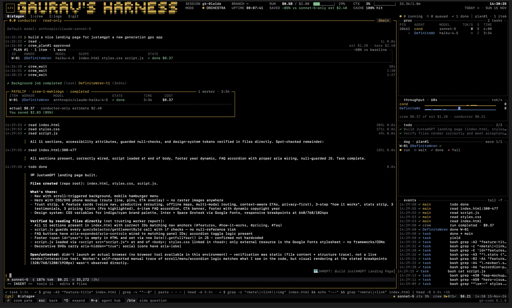
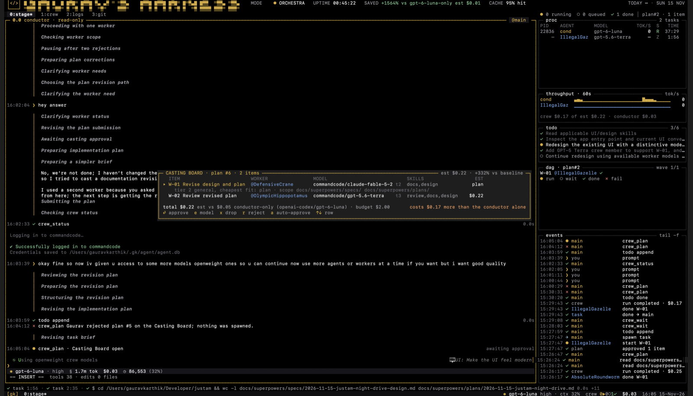
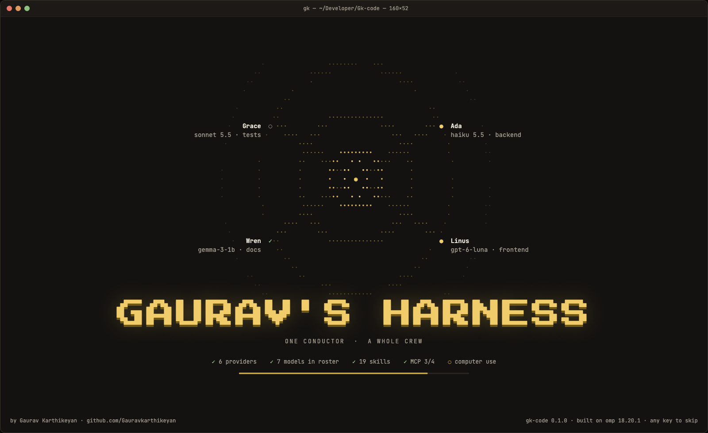
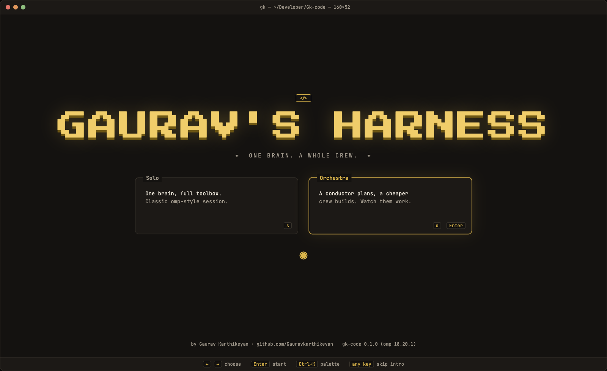
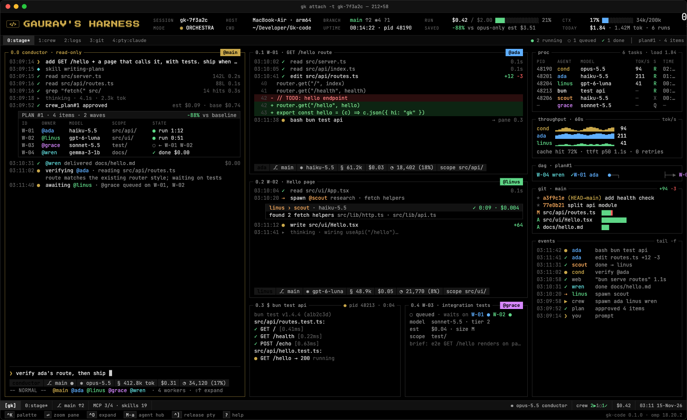
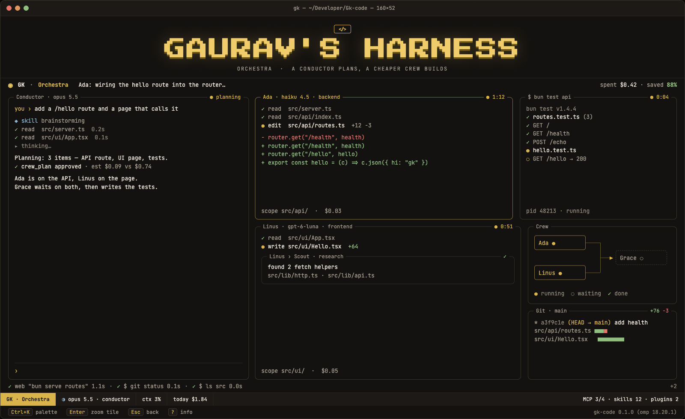
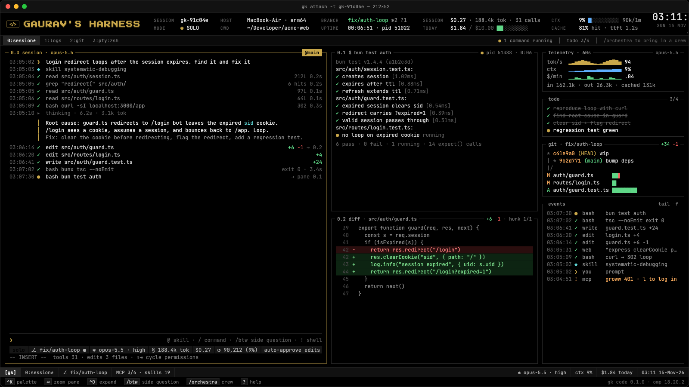
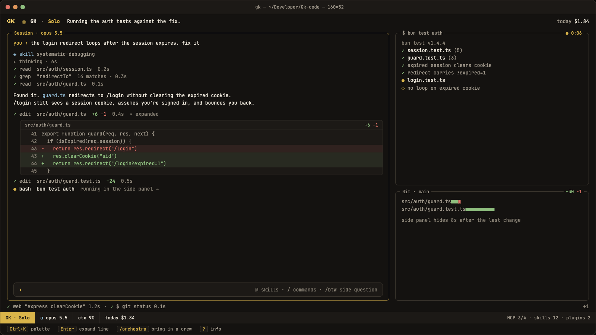
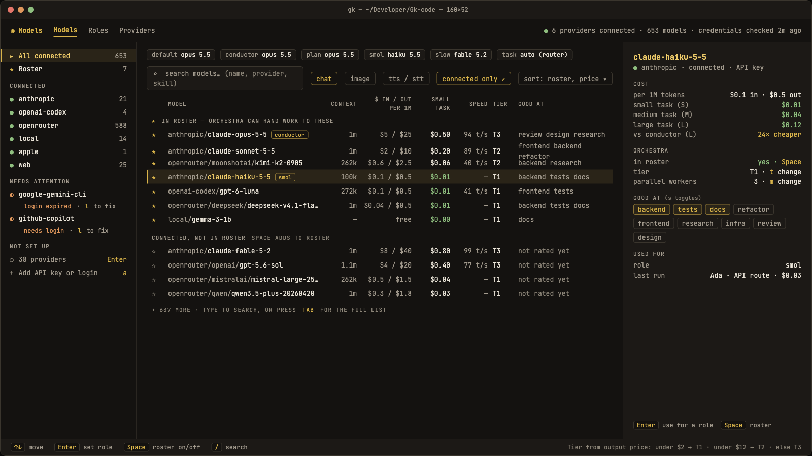

```
███  ██  █  █ ███   ██  █   █ █  ███    █  █  ██  ███  █   █ ████  ███  ███
█    █  █ █  █ █  █ █  █ █   █ █ █       █  █ █  █ █  █ ██  █ █    █    █
█ ██ ████ █  █ ███  ████ █   █    ██     ████ ████ ███  █ █ █ ███   ██   ██
█  █ █  █ █  █ █ █  █  █  █ █       █    █  █ █  █ █ █  █  ██ █       █    █
 ███ █  █  ██  █  █ █  █   █     ███     █  █ █  █ █  █ █   █ ████ ███  ███
```

**GK Code** (binary `gk-code`, short `gk`) is a terminal coding agent where an expensive model plans the work and cheaper models build it, all on one self-tiling screen.

It is Gaurav Karthikeyan's personal harness, built as a hard fork of [oh-my-pi](https://github.com/can1357/oh-my-pi) by Can Bölük and Stencil Labs, which is itself a fork of [Pi](https://github.com/badlogic/pi-mono) by Mario Zechner. It is in active development and not packaged for anyone else yet. See [Status](#status).

## Screenshots

Live captures from real sessions:

<table>
  <tr>
    <td width="50%"></td>
    <td width="50%"></td>
  </tr>
  <tr>
    <td>Orchestra run: the conductor's plan, one haiku worker, and the payslip at the end.</td>
    <td>Casting Board: each item, its worker, model and cost estimate, waiting for approval.</td>
  </tr>
</table>

Design references. These are the mockups the UI is built toward, not screenshots of the running app:

<table>
  <tr>
    <td width="50%"></td>
    <td width="50%"></td>
  </tr>
  <tr>
    <td>Splash</td>
    <td>Mode picker</td>
  </tr>
  <tr>
    <td></td>
    <td></td>
  </tr>
  <tr>
    <td>Orchestra on the Stage</td>
    <td>Orchestra, calmer layout</td>
  </tr>
  <tr>
    <td></td>
    <td></td>
  </tr>
  <tr>
    <td>Solo on the Stage</td>
    <td>Solo, calm preset</td>
  </tr>
  <tr>
    <td colspan="2"></td>
  </tr>
  <tr>
    <td colspan="2">Models and providers</td>
  </tr>
</table>

## What it does

### Solo mode

One agent with omp's full toolset and unchanged agent behavior, shown on GK's screen: the transcript fills the Stage, and a side rail with commands, diffs and widgets appears only while something is running. `/orchestra` switches the current session to Orchestra mode.

### Orchestra mode

A conductor model plans; a crew of cheaper models does the work.

1. **The conductor plans.** It reads the code, then calls `crew_plan` with work items. Each item has a self-contained brief, the skills it needs, a difficulty, a size and the paths it may write. The conductor is read-only: it can read, plan, advise and review, but not edit files or run commands.
2. **The router casts.** A deterministic function (no LLM call) gives each item to the cheapest connected model that clears the item's quality floor. Difficulty sets the floor, frontend, design and architecture work never goes below tier 2, and price never pushes an item under its floor. Items that could run at the same time may not have overlapping write scopes, so parallel workers do not clobber each other.
3. **You approve on the Casting Board.** Each row shows the item, the worker's name, the model, the reason it was picked and the estimated cost. The footer compares the total against a conductor-only baseline. Keys: `Enter` approve, `e` change a model, `x` drop a row, `r` reject with a note, `a` auto-approve for the session.
4. **Workers run in parallel** as live panes on the Stage. Each pane streams the worker's thinking, text and tool calls. Subagents a worker spawns show up nested inside its pane. Workers can ask the conductor a question with `ask_conductor` and wait for the answer.
5. **The conductor reviews.** It reads the changed files, sends fix-ups with `crew_send`, or escalates an item to a stronger model with `crew_escalate`.
6. **The payslip** closes the run: per worker model, state, time and cost, then actual spend against what the conductor alone would have cost. When the crew cost more, it says so.

Every run is appended to `~/.gk/agent/crew-ledger.jsonl`.

### The Stage

A full-screen Mission Control surface used by both modes, laid out like tmux but tiled by the harness, so there are no prefix keys or manual splits. It tiles itself from what is happening:

- Panes for the main agent or conductor, each worker, nested subagents, shell commands with live output, web calls and diffs.
- Widgets for processes, throughput, the crew DAG, git (graph and per-file diffstat), an event log and the todo list.
- A header with the wordmark, session, mode, branch, run spend and savings, context use, cache hit rate and today's spend.
- Pane order never changes; tiles grow and shrink with an attention weight, and finished commands collapse into a strip of chips.
- Focus a pane to zoom it or to type to that agent. `Ctrl+O` expands, `Alt+A` opens omp's Agent Hub.

`gk.stage.enabled: false` turns it off and gives you omp's classic inline UI.

### Launch, screens and commands

- **Splash and mode picker.** The pixel `GAURAV'S HARNESS` wordmark with a live startup checklist (providers, roster, skills, MCP, computer use), then a picker for Solo or Orchestra. `--solo` and `--orchestra` skip the picker.
- **`/models`.** A full-screen models and providers screen: connected providers, every model with context, price per 1M tokens, estimated cost per task size, speed and tier, plus role chips and roster on/off.
- **`/caps`.** One capabilities center for MCP servers, skills and plugins.
- **`Ctrl+K` palette.** Fuzzy search across commands, skills, models, settings and more.
- **`/credits` and `gk-code --credits`.** The credits card.
- **Daily spend.** Today's spend in the header, with a warning past `gk.budget.dailyUsd`.
- **Themes.** `gk-night` (black, gold accents) and `gk-day`.

### Bundled skills

19 skills ship in `packages/coding-agent/src/gk/skills/` and load with no setup. A user or project skill with the same name replaces the bundled copy. The set: `brainstorming`, `writing-plans`, `executing-plans`, `subagent-driven-development`, `systematic-debugging`, `test-driven-development`, `verification-before-completion`, `requesting-code-review`, `receiving-code-review`, `antislop`, `antislop-ui`, `antislop-human`, `antislop-layoutmobile`, `antislop-copywriting`, `antislop-code`, `impeccable`, `emil-design-eng`, `animate`, `break-ui`. Authors are listed under [Credits](#credits).

### Providers

Every provider omp supports works unchanged: 60+ providers, OAuth logins and custom `models.yml`. GK adds **AI Credits** (`aicredits`, an OpenAI-compatible gateway). Its discovery keeps only open-weight model families. Set `AICREDITS_API_KEY` or run `/login aicredits`.

## Install and run from source

GK Code runs from source; there is no published package. You need [Bun](https://bun.sh) 1.4.4 or newer and a Rust toolchain (`bun setup` builds the native addon).

```sh
git clone https://github.com/Gauravkarthikeyan/Gaurav-Harness.git
cd Gaurav-Harness
bun setup    # bun install, native build, then links gk and gk-code into Bun's global bin
```

Run it:

```sh
bun dev                  # from the repo
gk-code                  # from any directory; that directory becomes the session's project
gk --solo                # skip the mode picker
gk --orchestra
gk-code --version
gk-code --credits
```

The `gk` and `gk-code` wrappers live in Bun's global bin directory (`bun pm -g bin`, usually `~/.bun/bin`). Because they point at the repo, `git pull` is the update.

If `~/.gk` does not exist and you have an omp profile in `~/.omp/agent`, the first run offers to copy it so your logins, models and settings carry over.

## Configuration

GK keeps its data under `~/.gk/agent/` and project files under `.gk/`.

### Roster

The roster is the set of connected models the router may cast. It is built from every model with working credentials. Each model gets a default tier from its output price per 1M tokens (under $2 is tier 1, under $12 is tier 2, otherwise tier 3; zero-priced subscription or local models default to tier 2) and seeded strengths. Override any of that in `~/.gk/agent/roster.yml`:

```yaml
models:
  - selector: anthropic/claude-haiku-4-5
    tier: 1
    strengths: [docs, tests, refactor]
    maxConcurrent: 3
  - selector: openrouter/moonshotai/kimi-k2-0905
    tier: 2
    strengths: [frontend, backend, refactor]
  - selector: openrouter/openai/gpt-5.6-sol
    enabled: false
```

Skills are `frontend`, `backend`, `tests`, `docs`, `infra`, `refactor`, `research`, `review` and `design`. The `/models` screen edits the same file.

### Settings

| Setting | Default | What it does |
|---|---|---|
| `gk.launchMode` | `ask` | `ask` shows the mode picker; `solo` or `orchestra` skips it |
| `gk.orchestra.autoApprove` | `false` | Start crew plans without the Casting Board when they fit the run budget |
| `gk.orchestra.maxRunUsd` | `2` | Plans estimated above this need an explicit confirm on the board (0 = no budget) |
| `gk.budget.dailyUsd` | unset | Warn when today's spend passes this amount |
| `gk.stage.enabled` | `true` | The Stage; `false` restores omp's inline UI |
| `startup.showSplash` | `true` | The splash and startup checks |

The conductor is a model role (`conductor`). Unset, it uses the session's default model. Set it from `/models` or omp's model selector.

## Status

GK Code is a personal tool under active development. It is built and used on macOS (Apple Silicon); Linux should work but is not tested, and there are no releases.

Working and committed:

- Fork, rebrand to `gk-code` / `gk`, `.gk` paths and the omp profile import
- Roster, router, plan validation, crew runtime and run ledger
- Orchestra mode: conductor role and prompt, crew tools, Casting Board, payslip, `ask_conductor`, `/orchestra` and `--orchestra`
- The Stage: tile engine, layout, compositor, host, pane widgets and chrome
- Live worker panes that stream thinking, text and tool arguments, with nested subagent insets and zoom-to-steer
- Splash, mode picker, setup wizard restyle, `gk-night` and `gk-day` themes
- `/models`, `/caps`, `Ctrl+K` palette, `/credits`, daily spend meter
- The bundled skills pack and the AI Credits provider

In progress:

- Crew intelligence (implemented in the working tree, not yet committed): conductor-chosen models, a crew policy (`/crew policy`: open-weight only, providers, max tier, prefer quality), adding workers to a live run (`crew_add`), reassigning items (`crew_reassign`), a `crew_models` table, rejection notes that carry into the next plan, and payslip savings computed against the same work at the conductor's rates
- Finishing the debrand: many user-visible strings and docs still say omp
- Host tests for the Stage, and a live check of `/models` at full size
- Some existing tests fail; several of those failures predate the fork

## Vision

A terminal agent that feels like talking to one capable mind, while the work underneath is split across many models. The expensive model plans, briefs and reviews. Cheaper models do the token-heavy reading and writing. The bill should land well below what the expensive model would cost alone; a crew that costs more than the conductor alone counts as a failure, and the payslip shows it.

Everything observable becomes a tile: agents, subagents, commands, web calls, diffs, errors and git changes. The harness decides the layout, so you never manage panes. Gold is an accent, not the paint. Motion only happens while something is working, and errors are explained in plain English with the key that fixes them, never as a raw stack trace.

Everything omp already does well (providers, tools, sessions, LSP, MCP, subagents) stays, and GK's code lives in `packages/coding-agent/src/gk/` with small marked hook points elsewhere, so upstream omp updates can still be merged.

## Roadmap

Planned in the design spec and handoff notes, not built yet:

- **Crew intelligence, committed and tested.** Land the model awareness, crew policy, dynamic crew and advisor/review loop described above, and persist the conductor link so a worker revived after a restart can still ask questions.
- **Error tiles.** Harness-level failures (auth, rate limits, network, context overflow, budget, worker failure) open a tile with a headline, one cause line and one fix key. The stack trace goes to the log.
- **BUILD SUCCESSFUL finale and `/ship`.** After a real verification pass (the configured or detected test command), a full-screen finale, then the payslip or a session summary. A failed check shows BUILD FAILED with the failing output instead.
- **Computer-use tile.** The latest screenshot inline, a caption for the current action, and an action log, built on omp's `computer` tool.
- **External CLI panes.** `/open <command>` and a conductor-side `pane_open` run another CLI (`claude`, `codex`, another `gk-code`) in a real terminal pane on the Stage.
- **The Core and narration.** An animated status glyph that reflects what the agent is doing, and a one-line plain-English ticker in the header.
- **Voice.** Speak the final summary of each turn with omp's TTS, and push-to-talk input with omp's STT. Off by default.
- **Toasts.** Transient notices (model switched, skill loaded, MCP connected) show briefly above the composer and land in the event log instead of the transcript.
- **Upstream sync.** A script that merges oh-my-pi's `main` and lists GK's `// gk:` hook points to recheck.

## Credits

GK Code is built on [oh-my-pi](https://github.com/can1357/oh-my-pi) (omp) by **Can Bölük** and **Stencil Labs**, released under the MIT license. oh-my-pi is a fork of [Pi](https://github.com/badlogic/pi-mono) by **Mario Zechner**. GK Code would not exist without their work.

From omp, GK inherits nearly everything underneath the UI: the agent loop, 60+ model providers with OAuth logins and the model catalog, the built-in tools (edit, bash, search, browser, computer use and more), the LSP and debugger integrations, subagents and the Agent Hub, sessions and resume, MCP, plugins and skills discovery, memory, the TUI framework and its terminal rendering, the Rust natives, TTS and STT, and the SDK, RPC and ACP entry points.

GK adds Orchestra mode (conductor role, router, roster, Casting Board, crew runtime, payslip, ledger), the Stage, the splash and mode picker, the `/models` screen, `/caps`, the `Ctrl+K` palette, the credits card, the daily spend meter, the `gk-night` and `gk-day` themes, the AI Credits provider and the bundled skills pack.

The bundled skills belong to their authors:

| Skills | Author | Source | License |
|---|---|---|---|
| `brainstorming`, `writing-plans`, `executing-plans`, `subagent-driven-development`, `systematic-debugging`, `test-driven-development`, `verification-before-completion`, `requesting-code-review`, `receiving-code-review` | Jesse Vincent ([obra](https://github.com/obra)) | [superpowers](https://github.com/obra/superpowers) | MIT |
| `antislop`, `antislop-ui`, `antislop-human`, `antislop-layoutmobile`, `antislop-copywriting`, `antislop-code` | Miqdad Badjuber | [anti-slop](https://github.com/miqdadbadjuber/anti-slop) | MIT (`antislop-ui` and `antislop-human` include material from Addy Osmani's web-quality-skills, MIT) |
| `impeccable` | [pbakaus](https://github.com/pbakaus) | [impeccable](https://github.com/pbakaus/impeccable) | Apache 2.0 |
| `emil-design-eng`, `animate`, `break-ui` | Emil Kowalski | [emilkowalski/skill](https://github.com/emilkowalski/skill) | see source |

## License

MIT, inherited from oh-my-pi. See [LICENSE](LICENSE); the original copyright notices for Mario Zechner, Can Bölük and Stencil Labs stay in place.

## Based on oh-my-pi

GK Code tracks oh-my-pi closely, and most of omp's documentation applies here with `omp` read as `gk`. For omp's full feature tour, providers, tools, SDK, RPC and ACP docs, see the [oh-my-pi README](https://github.com/can1357/oh-my-pi#readme) and the [`docs/`](docs/) folder in this repo.
