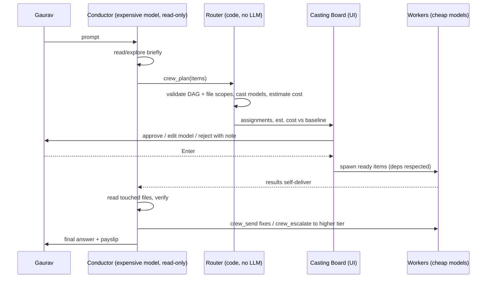

# GK Harness (Gaurav's Harness) — Design

Author: Gaurav Karthikeyan · github.com/Gauravkarthikeyan · gauravkarthik22@gmail.com
Status: draft for review · 2026-11-15

## 1. Intent

A personal, terminal-only coding agent harness. Base layer is a hard fork of
[oh-my-pi (omp)](https://github.com/can1357/oh-my-pi) so every provider, tool,
skill, plugin, MCP, LSP and session feature omp has comes for free. The one thing
GK Harness adds is an **Orchestra mode**: an expensive "conductor" model plans the
work and hands each piece to the cheapest connected model that can do it well,
then reviews the results. Goal: frontier-quality outcomes at a fraction of the
frontier-model bill, in a gold-themed TUI that is fun to watch.

Personal tool, not public. Polish goes to the UI; internals stay boring.

## 2. Goals / non-goals / anti-goals

Goals
- `gk-code` launches an animated gold **GK HARNESS** splash, then a mode picker: **Solo** or **Orchestra**.
- Solo = omp's interactive mode, rebranded, plus a daily-spend meter/budget warning and a `/orchestra` switch.
- Orchestra = conductor plans → router casts each work item to a model → user approves on a Casting Board →
  workers run in parallel in tmux-style split panes → conductor verifies → "payslip" shows spend vs. all-conductor baseline.
- Every provider omp supports works unchanged (60+ providers, OAuth logins, custom `models.yml`).
- Credits everywhere it fits: splash footer, `/credits`, `gk-code --credits`, `--version`.
- Can pull future omp updates (upstream merge stays practical).

Non-goals
- Re-implementing anything omp already ships (tools, providers, skills, plugins, MCP, LSP, DAP, memory, subagents, Agent Hub).
- A desktop/Electron/web UI. Terminal only.
- Public release, installers, marketplace, i18n.

Anti-goals (failure even if it "works")
- Orchestra costs **more** than just using the conductor alone for typical tasks.
- Workers silently editing the same files and clobbering each other.
- Breaking provider auth by touching provider request identity (User-Agent, fingerprint headers, OAuth client ids).
- Animations that slow startup or can't be skipped.

## 3. Research findings (what we reuse)

omp v18.20.1, commit `b7fe8c7f43c378faa0863e79f5509f9dde16ad9a` (2026-11-14), MIT. Bun + TypeScript monorepo, Rust N-API natives.

| Need | omp already has | Location |
|---|---|---|
| All providers/models/pricing | `pi-ai` (providers, auth, OAuth), `pi-catalog` (bundled `models.json`, `ModelCost` per 1M tokens, discovery) | `packages/ai`, `packages/catalog` |
| Model roles | `modelRoles` (default, smol, slow, plan, task, advisor, …) + custom roles | `packages/coding-agent/src/config/model-roles.ts` |
| Director/worker pattern | **Vibe mode**: read-only director + persistent worker sessions (`vibe_spawn/send/wait/kill/list`), tiers `fast`→`sonic`, `good`→`task` | `src/vibe/runtime.ts` (`VibeSessionRegistry`, `#resolveWorker`), `src/tools` vibe tool |
| Per-call worker model | task `model: "provider/id[:level]"`, gated by `task.perCallModel` | `src/task/*`, `docs/task-agent-discovery.md` |
| Watching/steering workers | Agent Hub (`Alt+A`), session focus (steer a worker by typing), pinned Subagents block | `src/modes/agent-hub-runtime.ts`, `controllers/session-focus-controller.ts` |
| Worker names | name generator | `src/task/name-generator.ts` |
| Splash + scenes | `runStartupSplash`, setup scenes (splash, model, theme, sign-in…) | `packages/tui/src/setup/` |
| Logo | `PI_LOGO`, `WORDMARK`, `gradientLogo` | `packages/tui/src/prompt/welcome.ts` |
| Theme system | JSON themes, validated, embedded `dark.json`/`light.json`, shimmer | `packages/tui/src/theme/` |
| Motion switch | `tui.motion` → `motion-effects.ts` | `packages/tui/src/motion-effects.ts` |
| Live multi-line board | `LiveBoard` | `packages/tui/src/chrome/live-board.ts` |
| Branding constants | `APP_NAME="omp"`, `CONFIG_DIR_NAME=".omp"` | `packages/utils/src/dirs.ts` |

pi-harness (wangmiaozero) is an Electron desktop app, **AGPL-3.0**. We take **ideas only, no code**:
per-run budgets, review gates before a task counts as done, a run ledger (who did what, cost), task DAG with dependencies.

## 4. Approaches considered

1. **Hard fork of omp, GK code in one folder (chosen).** Merge omp into this repo with an `upstream` remote;
   all new code lives under `packages/coding-agent/src/gk/` (+ a theme JSON and splash scene in `pi-tui`);
   touch omp files only at small, `// gk:`-marked hook points. Gets everything, keeps upstream merges feasible.
2. Thin wrapper depending on published `@oh-my-pi/*` npm packages + an omp extension. Cleanest upgrades, but
   extensions can't replace the launch flow, splash, layout, or vibe internals — Orchestra UI would be crippled.
3. Full rename (`@oh-my-pi/*` → `@gk/*`, all 23k "omp" strings). Feels "ours" but makes every upstream merge a
   conflict storm for zero user-visible gain.

## 5. Design

### 5.1 Identity & branding
- Binaries: `gk-code` and `gk`. Config root `~/.gk` (project dir `.gk/`). `APP_NAME="gk"`.
- Internal package names stay `@oh-my-pi/*` (upstream mergeability). Provider-facing identity
  (`USER_AGENT`, `packages/ai/src/providers/**`, auth) is **not touched**.
- First run: if `~/.gk` is missing and `~/.omp/agent` exists, offer a one-time import (copy) of omp's agent dir
  so existing logins/models/config work immediately.
- `--version` → `gk-code <version> (omp 18.20.1)`.

### 5.2 Look & feel ("golden CUI")
- **Principle: gold is the accent, not the paint.** Warm near-black neutrals carry 90 % of the screen; gold appears
  only where attention belongs: the brand mark, the focused/selected row, the active worker, the primary key hint.
  No boxes around everything, no rainbow status colors, no emoji in UI chrome.
- Two themes, auto-picked from terminal appearance (omp already detects dark/light): `gold` and `gold-light`.
  Contrast measured (WCAG ratio vs. background):

| Token | `gold` (bg `#141210`) | ratio | `gold-light` (bg `#FAF7F0`) | ratio | Used for |
|---|---|---|---|---|---|
| text | `#ECE6DA` | 15.0 | `#1F1B16` | 16.0 | body, assistant prose |
| muted | `#A39B8E` | 6.8 | `#6B6358` | 5.5 | secondary text, tool targets, timestamps |
| dim | `#6E675D` | 3.4 | `#8E8577` | 3.4 | non-essential hints only (never information-bearing) |
| accent (gold) | `#D9B44A` | 9.4 | `#8A6A12` | 4.7 | focus, selection, brand, active worker |
| accent bright | `#F0CD6A` | 12.1 | — | — | splash shimmer peak, payslip savings figure |
| success | `#8FBF7F` | 8.8 | `#3F7A32` | 4.9 | done, diff added |
| error | `#E5766A` | 6.4 | `#B23A2E` | 5.6 | failed, diff removed |
| warning | `#E0975C` | 7.8 | `#A65A1C` | 4.8 | budget, needs-auth |
| info/link | `#8DB4CC` | 8.5 | `#2F6688` | 5.8 | links, MCP/skill names |
| border | `#2A2621` | hairline | `#E6E0D3` | hairline | separators (decorative) |
| borderAccent | `#8A7234` | 4.0 | `#B8962E` | 2.6 | focused pane/card edge |
| surface | `#1C1916` | — | `#F2EEE4` | — | overlay/card background, selected row `#2A2418` |

- Splash: block-letter **GK HARNESS** revealed row by row, one gold shimmer sweep across it, then it settles.
  Tagline "Gaurav's Harness", footer "by Gaurav Karthikeyan · github.com/Gauravkarthikeyan". One-shot motion,
  nothing loops. ≤1.8 s, any key skips, disabled by `tui.motion: off`, non-TTY, `--quiet`, resume.
- In-session motion is limited to state changes: panes slide in once on split, a worker row flashes gold once on
  done, one-glyph spinner on running items only. No idle animation.
- Mode picker right after splash: two cards, ←/→ + Enter, `s`/`o` hotkeys, remembers last choice.
  `--solo` / `--orchestra` skip it; setting `gk.launchMode: ask|solo|orchestra` (default `ask`).

```
            ██████  ██   ██     ██   ██  █████  ██████  ███    ██ ███████ ███████ ███████
           ██       ██  ██      ██   ██ ██   ██ ██   ██ ████   ██ ██      ██      ██
           ██   ███ █████       ███████ ███████ ██████  ██ ██  ██ █████   ███████ ███████
           ██    ██ ██  ██      ██   ██ ██   ██ ██   ██ ██  ██ ██ ██           ██      ██
            ██████  ██   ██     ██   ██ ██   ██ ██   ██ ██   ████ ███████ ███████ ███████
                                       ✦  Gaurav's Harness  ✦
          ╭──────────── Solo ────────────╮   ╭────────── Orchestra ──────────╮
          │ One agent, full toolbox.     │   │ A conductor plans, a cheaper  │
          │ Classic omp-style session.   │   │ crew builds. Watch them work. │
          ╰──────────────────────────────╯   ╰───────────────────────────────╯
                     by Gaurav Karthikeyan · github.com/Gauravkarthikeyan
```

### 5.3 Solo mode
omp interactive mode as-is, plus:
- Status-line **today's spend** (sum of all sessions today from usage records) and a warning notice when it crosses
  `gk.budget.dailyUsd` (unset = no warning).
- `/orchestra` promotes the current session to conductor (enters Orchestra mode in place, like `/vibe`).
- `/credits`.

### 5.4 Orchestra mode



**Conductor.** Model = new role `conductor` (defaults to the session's default model). Tools: `read`, `todo`,
and the `crew_*` tools only — it cannot edit or run commands, which is what keeps its spend low (same mechanism as vibe).
Prompt: `prompts/gk/conductor.md` — split work into independent items with self-contained briefs, declare file
scopes, pick skills/difficulty/size honestly, verify by reading, escalate instead of redoing work itself.

**Work item** (what `crew_plan` takes):
- `id`, `title`, `brief` (self-contained; workers never see the conductor's chat)
- `skills`: subset of `frontend | backend | tests | docs | infra | refactor | research | review | design`
- `difficulty`: 1 mechanical · 2 solid engineering · 3 frontier judgment
- `size`: `S | M | L` → token estimate S = 60k in / 8k out, M = 250k / 30k, L = 800k / 80k (labelled "estimate")
- `dependsOn`: item ids; `scope`: path prefixes the item may write (e.g. `src/api/`, `package.json`)

**Validation** (rejects back to conductor with reasons): duplicate ids, unknown deps, cycles, empty brief,
and **overlapping write scopes between items that can run at the same time** (neither depends transitively on the other).
Overlap = one scope is a path prefix of the other. This is how parallel workers avoid clobbering each other
without worktree merges.

**Roster** = which connected models the router may use. Built from the live model registry (only models with
working credentials) merged with `~/.gk/agent/roster.yml` overrides:
`selector`, `tier` (1–3), `strengths` (skills), `enabled`, `maxConcurrent`.
Default tier from catalog output price per 1M tokens: `< $2` → 1, `< $12` → 2, else 3. Models with zero cost
(subscription/OAuth plans, local) default to tier 2 with `planIncluded: true`; the user corrects tiers in `roster.yml`
or via `/roster` (a selector UI listing models with tier/strength toggles).

**Router** (pure function, deterministic, no LLM call):
1. Eligible = enabled roster entries with `tier ≥ difficulty`.
2. `estCost = in × cost.input/1e6 + out × cost.output/1e6` (size table above).
3. `fit = |strengths ∩ skills| / |skills|`; `score = estCost × (1 − 0.3 × fit)`.
4. Pick lowest score; ties → higher fit → lower tier → selector alphabetical.
5. No eligible → conductor model, reason `"no eligible worker"`.
6. Baseline = Σ estCost(conductor model, item). Over `gk.orchestra.maxRunUsd` → board shows over-budget and approval requires an explicit `!`.
Each assignment carries a one-line human reason ("tier 1 backend, cheapest fit: $0.03").

**Casting Board** (overlay before anything spawns): rows = item → employee name (from omp's name generator) →
model → skills → est. cost; footer = total vs. baseline and savings %. Keys: Enter approve, `e` change a row's
model (picker limited to roster), `x` drop a row, `r` reject with a note (goes back to the conductor as tool error),
`a` toggle auto-approve for the rest of the session (`gk.orchestra.autoApprove`, default false).

**Workers.** Each item is a persistent worker session built on `VibeSessionRegistry`, extended to accept an explicit
model selector (bypassing the fast/good tier mapping). Bundled agent `task` (full coding tools). A scheduler starts
items whose deps are done, honouring `maxConcurrent`. Results self-deliver to the conductor like vibe.
`crew_escalate(item)` re-casts with `tier ≥ current+1` excluding the current model and sends the worker's
transcript summary + the conductor's note to the new worker.

**Ledger.** Every run appends JSONL to `~/.gk/agent/crew-ledger.jsonl`: run id, prompt head, items, model,
actual cost/tokens per worker (from usage events), baseline, status. `/crew history` lists runs.

**Payslip.** At run end, a gold card: per employee name/model/cost/duration/status, total actual vs. baseline,
"You saved $X (Y%)". Actual cost may exceed baseline; then it says so plainly.

### 5.5 Orchestra layout (tmux-style, in-process — not real tmux)

Before the first plan: one full-width composer, exactly like Solo. On approval the screen splits with a short
slide animation (respects `tui.motion`).

```
╭─ GK HARNESS · Orchestra ── conductor: claude-opus ── spent $0.42 · baseline $3.52 · saved 88% ─╮
│ CONDUCTOR                          │ ╭ Ada · claude-haiku · backend ─────────── ● running 1:12 ╮ │
│ Planning: 3 items…                 │ │ ✓ read src/server.ts                                  │ │
│ ✓ crew_plan approved               │ │ ● edit src/api/routes.ts                              │ │
│                                    │ ╰───────────────────────────────────────── $0.02 ──────╯ │
│                                    │ ╭ Linus · gpt-6-luna · frontend ───────────── ✓ done 2:40 ╮ │
│                                    │ │ ✓ wrote src/ui/App.tsx (+212)                         │ │
│                                    │ ╰───────────────────────────────────────── $0.11 ──────╯ │
│ > _                                │ ╭ Grace · deepseek · tests ─────────── ◌ waiting on Ada ╮ │
╰──────────────────────────────────────────────────────────────────────────────────────────────╯
```
- Left 40 % conductor transcript + composer; right a column of worker panes (last N activity lines each).
- `Alt+1…9` focus a worker full-screen (reuses omp session focus: read transcript, type to steer); `Esc` back.
- `Ctrl+G` toggles right side between column and grid. `Alt+A` Agent Hub still works.
- Width < 100 cols: stacked — conductor on top, one-line-per-worker strip at bottom.

### 5.6 UX rules (the "uncluttered" contract)
omp is powerful but dense. GK keeps omp's capabilities and changes the defaults and the surfaces:
1. **One line per tool call by default.** `✓ edit  src/api/routes.ts  +12 −3  0.4s` in muted text; Enter/click
   expands to omp's full card. Errors expand automatically. Thinking is collapsed to one dim line.
2. **Status line, four segments max:** mode · model · context % · today's spend. Everything else (git, cache,
   tokens/s) moves into the `?` info overlay.
3. **One entry point for everything: `Ctrl+K` command palette.** Fuzzy search across slash commands, skills, MCP
   servers, models, settings, sessions, and keybindings; every row shows its shortcut. `/` in the composer still works.
4. **Every screen has a real empty, loading, and error state** that says the cause and the next key to press
   ("No MCP servers yet. Press a to add one or i to import from Claude/Cursor configs").
5. **Plain-language errors** with a fix action, never a raw stack trace in the transcript (stack goes to the log).
6. **Keyboard first, mouse optional;** every overlay closes with Esc; the footer shows at most 4 key hints.
7. **Notices are toasts, not transcript spam:** transient info (model switched, skill loaded, MCP connected)
   renders as a 3-second line above the composer and lands in the `?` activity log.

### 5.7 Capabilities center: MCP, skills, plugins done properly
Today omp splits this across `/mcp` (text subcommands), `/skills`, `/plugins`, `/extensions`. GK adds one
overlay, **Capabilities** (`Ctrl+K → Capabilities`, or `/caps`), with three tabs; it calls omp's existing
managers underneath, no new backends.
- **MCP tab:** every server with scope (global/project), state (`connected · 14 tools`, `needs login`,
  `failed: <one-line reason>`, `disabled`). Keys: Space toggle on/off, `l` log in (OAuth inline), `t` list tools,
  `a` add (guided form: command or URL, env vars, scope), `i` import from `.claude`/`.cursor`/`.vscode` configs
  with a preview before saving, `r` restart, `x` remove (confirm). New servers start disabled until tested.
- **Skills tab:** each skill with source, one-line description, and on/off per project. `Enter` previews;
  `@` in the composer fuzzy-invokes a skill. When a skill loads during a turn the transcript shows one chip
  (`◆ skill  brainstorming`), never the file body.
- **Plugins tab:** installed plugins/extensions with enable, update, and remove; marketplace search via omp's
  existing marketplace.
- Activation state is visible at a glance in the status-line `?` overlay: `MCP 3/4 · skills 12 · plugins 2`.

## 6. Constraints
- Runtime: Bun ≥ 1.4.4 (omp requirement); Rust toolchain for `bun setup` (natives). Bun is **not installed** on this Mac yet.
- macOS arm64 primary; nothing should break Linux.
- License: omp MIT — keep its LICENSE and add Gaurav's copyright line. pi-harness AGPL — no code copied.

## 7. Calls made without Gaurav (correct any)
1. Hard fork with `@oh-my-pi/*` package names kept internally.
2. Router is deterministic code, not an LLM; the conductor only supplies skills/difficulty/size.
3. Parallel safety via declared non-overlapping write scopes, not per-worker git worktrees.
4. Approval board before spend by default; auto-approve is opt-in.
5. Workers use omp's `task` agent toolset; conductor is read-only.
6. Solo-mode improvements kept to: spend meter + budget warning, `/orchestra`, and the UX rules in §5.6–5.7
   (compact transcript, `Ctrl+K` palette, Capabilities center). Nothing else speculative.
7. GitHub handle `Gauravkarthikeyan` (from `gh`), email from git config.

## 8. Left to the builder
Exact pane rendering internals, animation curves, name list, card copy wording within the tone above, and how
usage events are aggregated for daily spend.
