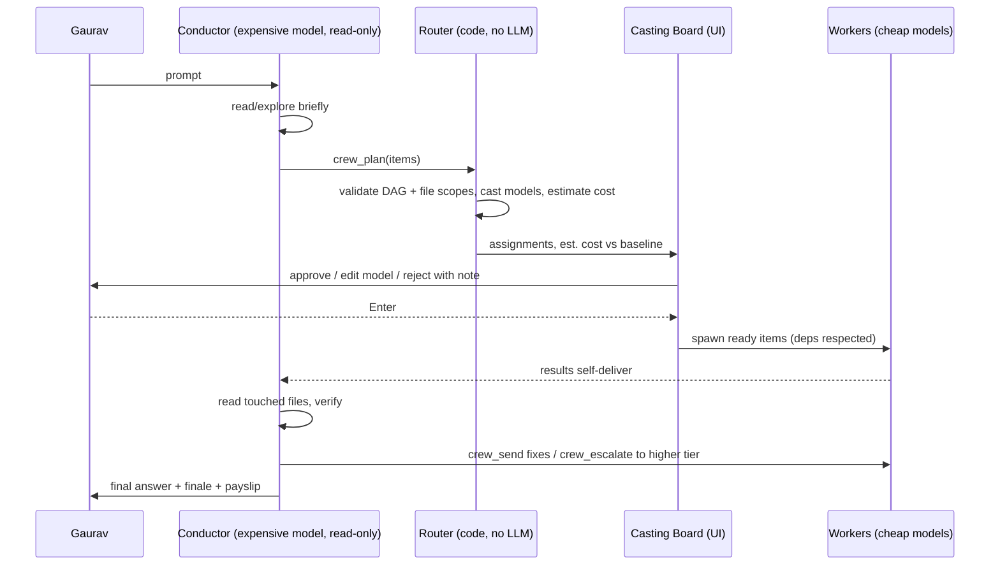

# GK Harness (Gaurav's Harness) — Design

Author: Gaurav Karthikeyan · github.com/Gauravkarthikeyan · gauravkarthik22@gmail.com
Status: draft for review · 2026-11-15 (rev 2: Stage, Core, finale, skills pack, launch anywhere)

## 1. Intent

A personal, terminal-only coding agent harness. Base layer is a hard fork of
[oh-my-pi (omp)](https://github.com/can1357/oh-my-pi) so every provider, tool,
skill, plugin, MCP, LSP and session feature omp has comes for free. GK adds:
- **Orchestra mode**: an expensive "conductor" model plans the work and hands each piece to the cheapest
  connected model that can do it well, then reviews the results. Frontier-quality outcomes at a fraction of the
  frontier-model bill.
- **The Stage**: a Mission Control screen that tiles itself. Every agent, subagent, shell command, web call,
  error, git change, computer-use action and external CLI becomes a live tile; the harness decides the layout.
- **The Core**: the feeling of talking to one superintelligent brain, not of operating a coding tool.

Personal tool, never public. Polish goes to the UI; internals stay boring.

## 2. Goals / non-goals / anti-goals

Goals
- Typing `gk-code` or `gk` in any terminal, in any directory, opens the harness in that directory.
- Animated gold **GK HARNESS** splash → mode picker (**Solo** / **Orchestra**) → the Core ignites → the live Stage.
- Solo = omp's agent behavior unchanged, with GK's UI: calm Stage, quiet transcript, `Ctrl+K` palette,
  Capabilities center, Core + narration, daily-spend meter, `/orchestra` switch.
- Orchestra = conductor plans → router casts each work item to a model → user approves on a Casting Board →
  workers run in parallel as Stage tiles → conductor verifies → **BUILD SUCCESSFUL** finale → payslip.
- Every observable thing is a tile, automatically; zero required shortcuts to get a good layout.
- Bundled skills pack (impeccable, antislop family, emil-design-eng, animate, break-ui, superpowers set) works
  out of the box.
- Every provider omp supports works unchanged (60+ providers, OAuth logins, custom `models.yml`).
- Credits: splash footer, `/credits`, `gk-code --credits`, `--version`.
- Can pull future omp updates (upstream merge stays practical).

Non-goals
- Re-implementing anything omp already ships (tools, providers, skills, plugins, MCP, LSP, DAP, memory, subagents,
  Agent Hub, PTY, VT emulation, TTS/STT, computer use, mermaid/charts, image protocols).
- A desktop/Electron/web UI. Terminal only.
- A multiplexer Gaurav has to drive (prefix keys, manual splits, saved layouts). Not real tmux.
- Public release, installers beyond `~/.local/bin` wrappers, marketplace, i18n, licensing work.

Anti-goals (failure even if it "works")
- Orchestra costs **more** than just using the conductor alone for typical tasks.
- Workers silently editing the same files and clobbering each other.
- Breaking provider auth by touching provider request identity (User-Agent, fingerprint headers, OAuth client ids).
- Animations that slow startup or can't be skipped; any animation while nothing is working; any animation with
  `tui.motion` off.
- A layout that jitters, reshuffles under the user's eyes, or makes Gaurav manage panes.
- Raw stack traces on screen.
- A green "BUILD SUCCESSFUL" without a passing verification behind it.

## 3. Research findings (what we reuse)

omp v18.20.1, commit `b7fe8c7f43c378faa0863e79f5509f9dde16ad9a` (2026-11-14), MIT. Bun + TypeScript monorepo, Rust N-API natives.

| Need | omp already has | Location |
|---|---|---|
| All providers/models/pricing | `pi-ai` (providers, auth, OAuth), `pi-catalog` (bundled `models.json`, `ModelCost` per 1M tokens, discovery) | `packages/ai`, `packages/catalog` |
| Model roles | `modelRoles` (default, smol, slow, plan, task, advisor, …) + custom roles | `packages/coding-agent/src/config/model-roles.ts` |
| Director/worker pattern | **Vibe mode**: read-only director + persistent worker sessions (`vibe_spawn/send/wait/kill/list`), tiers `fast`→`sonic`, `good`→`task` | `src/vibe/runtime.ts` (`VibeSessionRegistry`, `#resolveWorker`), `src/tools` vibe tool |
| Per-call worker model | task `model: "provider/id[:level]"`, gated by `task.perCallModel` | `src/task/*`, `docs/task-agent-discovery.md` |
| Agent lineage (incl. nested subagents) | `AgentRegistry` with `parentId`, events `registered` / `status_changed` / `metadata_changed` / `removed` | `src/registry/agent-registry.ts` |
| Watching/steering workers | Agent Hub (`Alt+A`), `agentTranscriptSource`, session focus (steer by typing) | `src/modes/agent-hub-runtime.ts`, `controllers/session-focus-controller.ts` |
| Tool-call intent | every tool call carries an intent field (`INTENT_FIELD`, "concise intent") | `@oh-my-pi/pi-wire`, `packages/agent/src/agent-loop.ts` (~l.1030) |
| Worker names | name generator | `src/task/name-generator.ts` |
| Splash + scenes | `runStartupSplash`, setup scenes (splash, model, theme, sign-in…) | `packages/tui/src/setup/` |
| Logo | `PI_LOGO`, `WORDMARK`, `gradientLogo` | `packages/tui/src/prompt/welcome.ts` |
| Theme system | JSON themes, validated, embedded `dark.json`/`light.json`, shimmer | `packages/tui/src/theme/` |
| Motion switch | `tui.motion` → `motionEffectsEnabled()`, `onMotionEffectsChange` | `packages/tui/src/motion-effects.ts` |
| Fullscreen | TUI borrows the alternate screen for a fullscreen overlay | `packages/tui/src/tui.ts` (~l.507, ~l.1083) |
| Width-safe strings | `visibleWidth`, `truncateToWidth`, `sliceByColumn` | `packages/tui/src/utils.ts` |
| Mouse | SGR mouse parse/route | `packages/tui/src/mouse.ts` |
| Frame pacing | frame-rate limiter, spinner clock | `packages/tui/src/frame-rate.ts`, `spinner-clock.ts` |
| Images in terminal | kitty graphics (Unicode placeholders), sixel, `Image` component | `packages/tui/src/kitty-graphics.ts`, `sixel.ts`, `components/image.ts` |
| Diagrams/charts | mermaid → ASCII (`resolveMermaidAscii`), chart planner | `packages/tui/src/theme/mermaid-cache.ts`, `packages/tui/src/charts/` |
| Live multi-line board | `LiveBoard` | `packages/tui/src/chrome/live-board.ts` |
| PTY | `PtySession` (`start`, `startArgv`, `write`, `resize`, `kill`) | `crates/pi-natives/src/pty.rs`, used by `src/tools/bash-interactive.ts` |
| VT emulator | `kitty-vt-wasm` (`KittyTerminal`, cell grid) — today a **devDependency** of `pi-tui`, used only by `packages/tui/test/virtual-terminal.ts` | `packages/tui/package.json` |
| Voice | TTS (`src/tts/*`, `commands/say.ts`), STT push-to-talk (`src/stt/push-to-talk.ts`, `stt-controller.ts`) | `packages/coding-agent/src/tts`, `src/stt` |
| Computer use | `computer` tool (`run`/`call`/`capabilities`/`close`, `details.screenshots`) + eval prelude `createComputerPrelude` | `src/tools/computer.ts`, `src/tools/computer/*` |
| Skill discovery | `registerProvider<Skill>(skillCapability.id, …)` + `scanSkillsFromDir`, priority-deduped by name | `src/discovery/builtin.ts` (~l.340–367) |
| Branding constants | `APP_NAME="omp"`, `CONFIG_DIR_NAME=".omp"` | `packages/utils/src/dirs.ts` |

pi-harness (wangmiaozero) is an Electron desktop app, **AGPL-3.0**. We take **ideas only, no code**:
per-run budgets, review gates before a task counts as done, a run ledger (who did what, cost), task DAG with dependencies.

## 4. Approaches considered

1. **Hard fork of omp, GK code in one folder (chosen).** Merge omp into this repo with an `upstream` remote;
   all new code lives under `packages/coding-agent/src/gk/` (+ a theme JSON and splash scene in `pi-tui`);
   touch omp files only at small, `// gk:`-marked hook points. Gets everything, keeps upstream merges feasible.
2. Thin wrapper depending on published `@oh-my-pi/*` npm packages + an omp extension. Cleanest upgrades, but
   extensions can't replace the launch flow, splash, layout, or vibe internals — Orchestra UI would be crippled.
3. Full rename (`@oh-my-pi/*` → `@gk/*`, all 23k "omp" strings). Feels "ours" but makes every upstream merge a
   conflict storm for zero user-visible gain.

Stage layout, considered: (a) fixed split panes (old §5.5) — breaks as soon as a 4th thing happens; (b) squarified
treemap — best aspect ratios but sorts by size, so tiles jump whenever weights change; (c) **ordered weighted
binary split over the lineage tree (chosen)** — near-square tiles, order never changes, children stay inside
their parent's area.

## 5. Design

### 5.1 Identity, branding, launch
- Binaries: `gk-code` and `gk`. Config root `~/.gk` (project dir `.gk/`). `APP_NAME="gk"`.
- Internal package names stay `@oh-my-pi/*` (upstream mergeability). Provider-facing identity
  (`USER_AGENT`, `packages/ai/src/providers/**`, auth) is **not touched**.
- First run: if `~/.gk` is missing and `~/.omp/agent` exists, offer a one-time import (copy) of omp's agent dir
  so existing logins/models/config work immediately.
- `--version` → `gk-code <version> (omp 18.20.1)`.
- **Launch anywhere.** `scripts/install-gk.sh` writes two executable wrappers, `~/.local/bin/gk-code` and
  `~/.local/bin/gk` (already on PATH on this Mac), each `exec <abs bun> <repo>/packages/coding-agent/src/cli.ts "$@"`.
  No `cd`, so the caller's cwd is the session's project. Runs from source (no compiled binary), so `git pull` in the
  repo is the update. Idempotent; refuses to overwrite a same-named file it didn't write (marker line) unless `--force`.

### 5.2 Look & feel ("golden CUI")
> Look & feel superseded by [`2026-11-15-gk-visual-v2.md`](2026-11-15-gk-visual-v2.md) (black base, sparse gold, gk-night/gk-day).
- **Principle: gold is the accent, not the paint.** Warm near-black neutrals carry 90 % of the screen; gold appears
  only where attention belongs: the brand mark, the Core, the focused tile/row, the primary key hint. Green is
  reserved for success (and the finale), red for errors. No rainbow status colors, no emoji in UI chrome.
- Two themes, auto-picked from terminal appearance (omp already detects dark/light): `gold` and `gold-light`.
  Contrast measured (WCAG ratio vs. background):

| Token | `gold` (bg `#141210`) | ratio | `gold-light` (bg `#FAF7F0`) | ratio | Used for |
|---|---|---|---|---|---|
| text | `#ECE6DA` | 15.0 | `#1F1B16` | 16.0 | body, assistant prose |
| muted | `#A39B8E` | 6.8 | `#6B6358` | 5.5 | secondary text, tool targets, timestamps |
| dim | `#6E675D` | 3.4 | `#8E8577` | 3.4 | non-essential hints only (never information-bearing) |
| accent (gold) | `#D9B44A` | 9.4 | `#8A6A12` | 4.7 | focus, selection, brand, Core, active worker |
| accent bright | `#F0CD6A` | 12.1 | — | — | splash shimmer peak, Core pulse peak, payslip savings figure |
| success | `#8FBF7F` | 8.8 | `#3F7A32` | 4.9 | done, diff added, BUILD SUCCESSFUL |
| error | `#E5766A` | 6.4 | `#B23A2E` | 5.6 | failed, diff removed, error tiles, BUILD FAILED |
| warning | `#E0975C` | 7.8 | `#A65A1C` | 4.8 | budget, needs-auth |
| info/link | `#8DB4CC` | 8.5 | `#2F6688` | 5.8 | links, MCP/skill names, web tiles |
| border | `#2A2621` | hairline | `#E6E0D3` | hairline | tile frames (unfocused), separators |
| borderAccent | `#8A7234` | 4.0 | `#B8962E` | 2.6 | focused tile edge |
| surface | `#1C1916` | — | `#F2EEE4` | — | overlay/card background, selected row `#2A2418` |

- **Motion rule: motion means work.** Animation is allowed only while it reflects live state (Core while the brain
  works, tile reflow when attention shifts, a running spinner, the one-shot error glitch, the finale). Nothing moves
  while idle. `tui.motion: off`, non-TTY, `--quiet` and resume make every effect static (final frame immediately).
- **Splash** (≤ 2.5 s of motion, any key skips): block-letter **GK HARNESS** revealed row by row (600 ms), one gold
  shimmer sweep (800 ms), tagline "Gaurav's Harness", footer "by Gaurav Karthikeyan · github.com/Gauravkarthikeyan";
  mode cards fade in under the logo. After the choice (or immediately when the mode is preset): the **Core ignites**
  at center (`·` → `•` → `●` → `◉` with a one-ring gold burst, 500 ms), then the logo lifts away while the Core
  glides to its header slot and the Stage's tile frames draw in (400 ms) — a continuous move, not a cut.
- Mode picker: two cards, ←/→ + Enter, `s`/`o` hotkeys, remembers last choice. `--solo` / `--orchestra` skip it;
  setting `gk.launchMode: ask|solo|orchestra` (default `ask`).

```
            ██████  ██   ██     ██   ██  █████  ██████  ███    ██ ███████ ███████ ███████
           ██       ██  ██      ██   ██ ██   ██ ██   ██ ████   ██ ██      ██      ██
           ██   ███ █████       ███████ ███████ ██████  ██ ██  ██ █████   ███████ ███████
           ██    ██ ██  ██      ██   ██ ██   ██ ██   ██ ██  ██ ██ ██           ██      ██
            ██████  ██   ██     ██   ██ ██   ██ ██   ██ ██   ████ ███████ ███████ ███████
                                       ✦  Gaurav's Harness  ✦
          ╭──────────── Solo ────────────╮   ╭────────── Orchestra ──────────╮
          │ One brain, full toolbox.     │   │ A conductor plans, a cheaper  │
          │ Classic omp-style session.   │   │ crew builds. Watch them work. │
          ╰──────────────────────────────╯   ╰───────────────────────────────╯
                                                 ◉
                     by Gaurav Karthikeyan · github.com/Gauravkarthikeyan
```

### 5.3 Solo mode
omp's agent behavior unchanged (same tools, same prompts plus the small persona block in §5.6), with:
- The Stage in **calm preset** (§5.5): transcript dominant; a side rail appears only while something is live
  (command, web call, subagent, error, computer use, external pane) and disappears when it all settles.
- Core + narration ticker in the header (§5.6).
- Status-line **today's spend** and a warning notice when it crosses `gk.budget.dailyUsd` (unset = no warning).
- `/orchestra` promotes the current session to conductor (enters Orchestra mode in place, like `/vibe`).
- `/ship` runs final verification and plays the finale (§5.9). `/open <command>` opens an external CLI pane (§5.11).
- `/credits`.

### 5.4 Orchestra mode



**Conductor.** Model = new role `conductor` (defaults to the session's default model). Tools: `read`, `todo`,
the `crew_*` tools, and the Stage tools `pane_open` / `stage_focus` — it cannot edit or run commands, which is
what keeps its spend low (same mechanism as vibe). Prompt: `prompts/gk/conductor.md` — split work into independent
items with self-contained briefs, declare file scopes, pick skills/difficulty/size honestly, verify by reading,
escalate instead of redoing work itself.

**Work item** (what `crew_plan` takes):
- `id`, `title`, `brief` (self-contained; workers never see the conductor's chat)
- `skills`: subset of `frontend | backend | tests | docs | infra | refactor | research | review | design`
- `difficulty`: 1 mechanical · 2 solid engineering · 3 frontier judgment
- `size`: `S | M | L` → token estimate S = 60k in / 8k out, M = 250k / 30k, L = 800k / 80k (labelled "estimate")
- `dependsOn`: item ids; `scope`: path prefixes the item may write (e.g. `src/api/`, `package.json`); empty = read-only item

**Validation** (rejects back to conductor with reasons): duplicate ids, unknown deps, cycles, empty brief,
and **overlapping write scopes between items that can run at the same time** (neither depends transitively on the other).
Overlap = one scope is a path prefix of the other. This is how parallel workers avoid clobbering each other
without worktree merges.

**Roster** = which connected models the router may use. Built from the live model registry (only models with
working credentials) merged with `~/.gk/agent/roster.yml` overrides:
`selector`, `tier` (1–3), `strengths` (skills), `enabled`, `maxConcurrent`.
Default tier from catalog output price per 1M tokens: `< $2` → 1, `< $12` → 2, else 3. Models with zero cost
(subscription/OAuth plans, local) default to tier 2 with `planIncluded: true`; the user corrects tiers in `roster.yml`
or via `/roster` (a selector UI listing models with tier/strength toggles).

**Router** (pure function, deterministic, no LLM call):
1. Eligible = enabled roster entries with `tier ≥ difficulty`.
2. `estCost = in × cost.input/1e6 + out × cost.output/1e6` (size table above).
3. `fit = |strengths ∩ skills| / |skills|`; `score = estCost × (1 − 0.3 × fit)`.
4. Pick lowest score; ties → higher fit → lower tier → selector alphabetical.
5. No eligible → conductor model, reason `"no eligible worker"`.
6. Baseline = Σ estCost(conductor model, item). Over `gk.orchestra.maxRunUsd` → board shows over-budget and approval requires an explicit `!`.
Each assignment carries a one-line human reason ("tier 1 backend, cheapest fit: $0.03").

**Casting Board** (overlay on the Stage before anything spawns): rows = item → employee name (from omp's name
generator) → model → skills → est. cost; footer = total vs. baseline and savings %. Keys: Enter approve, `e` change a
row's model (picker limited to roster), `x` drop a row, `r` reject with a note (goes back to the conductor as tool
error), `a` toggle auto-approve for the rest of the session (`gk.orchestra.autoApprove`, default false).

**Workers.** Each item is a persistent worker session built on `VibeSessionRegistry`, extended to accept an explicit
model selector (bypassing the fast/good tier mapping). Bundled agent `task` (full coding tools). A scheduler starts
items whose deps are done, honouring `maxConcurrent`. Results self-deliver to the conductor like vibe. Each worker
(and every subagent it spawns) appears on the Stage as an agent tile under its parent.
`crew_escalate(item)` re-casts with `tier ≥ current+1` excluding the current model and sends the worker's
transcript summary + the conductor's note to the new worker.

**Ledger.** Every run appends JSONL to `~/.gk/agent/crew-ledger.jsonl`: run id, prompt head, items, model,
actual cost/tokens per worker (from usage events), baseline, status. `/crew history` lists runs.

**Payslip.** At run end, after the finale: a gold card: per employee name/model/cost/duration/status, total actual
vs. baseline, "You saved $X (Y%)". Actual cost may exceed baseline; then it says so plainly.

### 5.5 The Stage (Mission Control) — replaces the old fixed Orchestra split layout

One full-screen surface (alternate screen, via the TUI's fullscreen-overlay mechanism) used by both modes.
No prefix keys, no split keys, no saved layouts: the harness tiles the screen itself from what is happening.

```
◉ GK · Orchestra   Ada: wiring the hello route into the router…                spent $0.42 · saved 88%
╭─ Conductor · claude-opus ─────────────╮╭─ Ada · haiku · backend ── ● 1:12 ─╮╭─ $ bun test api ── ● 0:04 ─╮
│ Planning: 3 items…                    ││ ✓ read src/server.ts              ││ ✓ routes.test.ts (3)        │
│ ✓ crew_plan approved                  ││ ● edit src/api/routes.ts          ││ ● hello.test.ts             │
│ Ada is on the API, Linus on the page. │╰───────────────────────────────────╯╰─────────────────────────────╯
│                                       │╭─ Linus · gpt-6-luna · frontend ── ● 0:51 ─╮╭─ Crew ──────────────╮
│                                       ││ ● write src/ui/Hello.tsx (+64)            ││ [Ada ●]──▶[Grace ◌]│
│                                       ││ ╭─ Linus › Scout · research ── ✓ ─╮       ││ [Linus ●]──┘       │
│ > _                                   ││ │ found 2 fetch helpers            │       │╰────────────────────╯
╰───────────────────────────────────────╯╰───────────────────────────────────────────╯
 ✓ web "bun serve routes" 1.1s · ✓ $ git status 0.1s · ✓ $ ls src 0.0s
```

**Tiles.** Every tile has `kind`, `parentId` (lineage), `state` (`running | idle | done | error`), `createdAt`,
`lastActivityAt`, `endedAt`, and a computed attention weight. Kinds and sources:

| Kind | Created when | Parent | Content |
|---|---|---|---|
| `transcript` | session start (main agent / conductor) | — | omp chat + composer, scrolls in-tile |
| `agent` | `AgentRegistry` `registered` (workers, task subagents, nested subagents at any depth) | `parentId` from the registry | `Name · model · skill`, state + elapsed, last activity lines, cost; lineage title `Ada › Scout` |
| `command` | `bash` tool start, any agent | calling agent | `$ command` header, live streamed output (ANSI kept, `\r` overwrites), `exit N · 2.1s` footer |
| `web` | `web_search`, `fetch`, `read` of an `http(s)` URL | calling agent | query or URL, provider, status, 3-line result preview |
| `error` | harness-level failure (§5.7) | source tile | headline, cause, fix key |
| `git` | repo has changes or a commit happens | — | branch graph + per-file diffstat bars (§5.8) |
| `dag` | Orchestra plan approved | conductor | live crew DAG (§5.8) |
| `timeline` | Orchestra run starts, or on request | — | every event, one line each (§5.8) |
| `computer` | `computer` tool call | calling agent | latest screenshot, action caption, action log (§5.10) |
| `pty` | `/open <command>` or `pane_open` | — | real terminal running another CLI (§5.11) |

A non-zero exit from a command is **not** an error tile (agents run failing tests on purpose); the command tile
shows a red exit code and lingers longer.

**Attention weight** (recomputed on a 500 ms tick and on every event):
`weight = KIND_BASE[kind] × STATE_MUL[state] × (1 + e^(−(now − lastActivityAt)/8000)) × (focused ? 2.5 : 1)`
- `KIND_BASE`: transcript 4 · error 2.5 · agent 2 · pty 2 · computer 2 · dag 1.5 · git 1 · command 1 · timeline 0.8 · web 0.6
- `STATE_MUL`: error 2 · running 1.6 · idle 0.6 · done 0.35
- A tile's subtree weight = its weight + Σ children's subtree weights.

**Chips (the "recent" strip).** Short-lived tiles leave the tiling and become one-line chips in a strip on the last
screen row, newest first, overflow `+N`: `command`/`web` 4 s after done (8 s after a failed exit); nested subagents
10 s after done; workers 30 s after done and only when no descendant is still running; error tiles only after
dismissal; `pty` 10 s after the process exits. Clicking a chip (or naming it) restores it as a tile.

**Layout algorithm** (pure `layoutStage`, deterministic, unit-tested):
1. Row 0 = header (Core, narration, spend). Last row = chip strip when any chips exist. The rest is the body.
2. Zoomed tile → it gets the whole body; everything else hidden. Done.
3. Preset split of the body:
   - `solo` (calm): no live non-transcript tiles → transcript takes the body. Otherwise a right rail of width
     `clamp(round(cols × 0.34), 30, cols − 60)`; below 90 cols the rail stacks under the transcript with height
     `clamp(round(bodyRows × 0.35), 6, bodyRows − 10)`. In calm preset `git`/`timeline`/`dag` tiles only show while live
     (git: 8 s after a change).
   - `orchestra`: transcript (conductor) width `clamp(round(cols × 0.36), 40, round(cols × 0.5))` on the left; below
     100 cols it stacks on top with height `max(10, round(bodyRows × 0.45))`.
4. The remaining region is filled by the **lineage tree**: roots = tiles whose parent is the transcript's agent or
   none, in `createdAt` order; each node's children follow it in `createdAt` order.
5. **Ordered weighted binary split**: for a list of nodes in a rect, choose the split index `k` minimising
   `|Σw[<k] − Σw[≥k]|` (smallest `k` on ties); cut horizontally when `rect.h × 2 ≥ rect.w` (cells are ~2:1),
   else vertically; first part = `round(dim × Σw[<k] / Σw)`, clamped to leave each side ≥ the minimum; recurse.
   A node with children splits its rect into [own tile, ...children] the same way, so subagents always sit inside
   their parent's area.
6. **Minimum tile 24 × 5** (frame + 3 content rows). If any rect would be smaller, demote the lowest-weight demotable
   tile (never the transcript, the focused or a pinned tile; error tiles last; demoting an agent demotes its
   subtree) to a chip and re-run.
7. **Hysteresis:** with the same visible tile set, keep the previous layout unless some edge moves ≥ 2 cells.
8. **Tween:** layout changes animate over 150 ms (ease-out cubic) by interpolating tile *weights* (new tiles from 0,
   leaving tiles to 0) and the rail fraction, re-running the pure layout each frame — every frame is a valid tiling.
   Minimum-size demotion is suspended mid-tween; zero-area rects are skipped. Motion off → snap. Terminal resize →
   snap and full repaint.

**Compositor.** Each tile renders `string[]` for its exact inner size (pi-tui `Component.render(width)` model,
cached per tile by `(w, h, version)`, re-rendered only when dirty). The compositor draws frames (rounded,
`border`; focused `borderAccent`; error `error`) and blits rows into a full-screen frame: for each screen row,
concatenate the intersecting tile slices in x order, each padded/truncated with `visibleWidth`/`truncateToWidth`
and closed with an SGR reset so colors never bleed. Tiles never overlap, so no z-order. Output goes through pi-tui's
differential renderer, capped by `frame-rate.ts`.

**Focus & zoom.** Focus = mouse click on a tile, or the conductor/agent naming it (`stage_focus`), or Gaurav asking
("show me Ada"). Enter on a focused tile zooms it full screen; Esc returns; Esc again clears focus. Typing with an
agent tile focused steers that agent (omp session focus). Mouse wheel scrolls the tile under the cursor. These are
conveniences — the layout is good with zero keys pressed. `Alt+A` Agent Hub still works.

**Escape hatch.** `gk.stage.enabled: false` → omp's classic inline UI (scrollback, no tiles).

### 5.6 The Core, narration, voice (the "JARVIS" feel)
- **Core**: one glyph at the left of the header, animated only while working:
  idle `◉` muted, still · thinking `◉` pulses borderAccent → accent → accentBright (1.6 s cycle) ·
  tools running `◴◷◶◵` orbit (120 ms/frame) accent · listening `◎` info · speaking `◉` accentBright ·
  error `◉` flickers error/dim for 600 ms then steady error until dismissed. Precedence: error > listening >
  speaking > tools > thinking > idle. Motion off → each state's static glyph.
- **Narration ticker**: one plain-English line after the Core saying what the brain is doing now. Source: the
  intent string every tool call carries (`INTENT_FIELD`), prefixed with the worker's name when it isn't the main
  agent ("Ada: Wiring the hello route"); crew events ("Linus finished the page"); conductor phases ("Planning 3
  items"). Each line holds ≥ 700 ms; idle shows the last line dimmed.
- **Persona** (`prompts/gk/persona.md`, ≤ 6 lines, both modes): you are GK, Gaurav's harness; speak to Gaurav
  directly, in plain English, confident and concise; no hedging filler; when done, say what changed and how it was
  verified.
- **Voice** (`gk.voice`, default off): speaks the final summary of each main turn through omp's TTS (`src/tts`);
  push-to-talk through omp's STT (`src/stt/push-to-talk.ts`) when present. Core shows listening/speaking.

### 5.7 Errors are an event
Harness-level failures (provider/auth, rate limit, network, context overflow, budget, tool crash, agent/worker
failure, PTY spawn failure) open an **error tile**: glitch-in once (≤ 300 ms of scrambled rows settling; skipped
with motion off), red border, big headline (block letters when the tile is ≥ 60 cols wide, bold text otherwise),
one plain-English cause line, and the one fix action with its key ("Press l to log in to Anthropic"). The stack
trace goes to the log only; `d` on the tile opens the log excerpt. Unknown errors still get a headline ("Something
broke in <source>") — never a raw trace. Dismiss with `x`, or automatically when the same source next succeeds.

### 5.8 Diagrams
- **Crew DAG tile**: items as nodes labelled `Name state-glyph title`, edges = `dependsOn`, colored by state
  (waiting muted, running accent, done success, failed error). Rendered with omp's `resolveMermaidAscii` from a
  generated `flowchart LR`; if mermaid can't render or it doesn't fit, a layered text fallback (longest-path layers).
- **Git tile**: `git log --graph --oneline --decorate -n 15` recolored (graph muted, hashes dim, refs accent), then
  per-file diffstat bars from `git diff --numstat HEAD` (`+` part success, `−` part error, scaled to the largest
  file). Refreshes 800 ms after any edit/write/bash tool ends. Read-only git commands only. Not a repo → no tile.
- **Timeline tile**: every Stage event, one line (`12:04:31  Ada  ✓ edit src/api/routes.ts`); doubles as the
  activity log toasts land in (§5.12 rule 7).

### 5.9 BUILD SUCCESSFUL finale
- Triggers: an Orchestra run ends with every item `done`; `/ship`; or a session's todo list becomes all-completed
  (≥ 2 todos) and `gk.finale.autoVerify` (default on) runs the verify command and it passes.
- Verify command: `gk.verifyCommand`, else detected (package.json `check` then `test` script with the lockfile's
  package manager · `cargo test` · `go test ./...` · `pytest` · `make test`). None found → no finale, a notice
  says how to set one. No green without a pass.
- Success: full-screen, giant green block-letter **BUILD SUCCESSFUL** (wraps to two lines on narrow screens, bold
  text below 60 cols), particle burst from center (~2.5 s, success/accent/accentBright), then the payslip (Orchestra)
  or a session summary (Solo: duration, cost, files changed, verify command + time). Any key skips to the summary.
- Failure: honest red **BUILD FAILED**, static, listing failing items (Orchestra) or the failing command with its
  last 10 output lines. Cancelled runs get no finale.

### 5.10 Computer use
The `computer` tile shows the latest screenshot inline (kitty Unicode placeholders, which compose as text inside
tiles; sixel only when the tile is zoomed; text fallback `screenshot 1440×900` otherwise), a caption on the image's
last row with the action being performed (`▶ click (812, 404)` / `type "hello"` / `key cmd+s`), and an action log.
Built on omp's existing `computer` tool and its eval prelude; no new desktop backend.

### 5.11 External terminal panes
`/open <command>` (Gaurav) and `pane_open({ command, title? })` (conductor) open a `pty` tile running the command via
`$SHELL -lc` in the session cwd — `claude`, `codex`, another `gk-code`, anything. Backed by omp's native
`PtySession` and the `kitty-vt-wasm` emulator (promoted from devDependency). Focusing the pane sends every keystroke
to the child, including Esc; `Ctrl+]` or a click outside releases it. The PTY resizes with its tile. Children are
killed when the session ends.

### 5.12 UX rules (the "uncluttered" contract)
omp is powerful but dense. GK keeps omp's capabilities and changes the defaults and the surfaces:
1. **One line per tool call by default.** `✓ edit  src/api/routes.ts  +12 −3  0.4s` in muted text; Enter/click
   expands to omp's full card. Errors expand automatically. Thinking is collapsed to one dim line.
2. **Status line, four segments max:** mode · model · context % · today's spend. Everything else (git, cache,
   tokens/s) moves into the `?` info overlay.
3. **One entry point for everything: `Ctrl+K` command palette.** Fuzzy search across slash commands, skills, MCP
   servers, models, settings, sessions, Stage tiles, and keybindings; every row shows its shortcut. `/` in the
   composer still works.
4. **Every screen has a real empty, loading, and error state** that says the cause and the next key to press
   ("No MCP servers yet. Press a to add one or i to import from Claude/Cursor configs").
5. **Plain-language errors** with a fix action (error tiles, §5.7), never a raw stack trace on screen.
6. **Keyboard first, mouse welcome;** every overlay closes with Esc; the footer shows at most 4 key hints.
7. **Notices are toasts, not transcript spam:** transient info (model switched, skill loaded, MCP connected)
   renders as a 3-second line above the composer and lands in the timeline/activity log.

### 5.13 Capabilities center: MCP, skills, plugins done properly
Today omp splits this across `/mcp` (text subcommands), `/skills`, `/plugins`, `/extensions`. GK adds one
overlay, **Capabilities** (`Ctrl+K → Capabilities`, or `/caps`), with three tabs; it calls omp's existing
managers underneath, no new backends.
- **MCP tab:** every server with scope (global/project), state (`connected · 14 tools`, `needs login`,
  `failed: <one-line reason>`, `disabled`). Keys: Space toggle on/off, `l` log in (OAuth inline), `t` list tools,
  `a` add (guided form: command or URL, env vars, scope), `i` import from `.claude`/`.cursor`/`.vscode` configs
  with a preview before saving, `r` restart, `x` remove (confirm). New servers start disabled until tested.
- **Skills tab:** each skill with source (bundled GK skills show `gk`), one-line description, and on/off per
  project. `Enter` previews; `@` in the composer fuzzy-invokes a skill. When a skill loads during a turn the
  transcript shows one chip (`◆ skill  brainstorming`), never the file body.
- **Plugins tab:** installed plugins/extensions with enable, update, and remove; marketplace search via omp's
  existing marketplace.
- Activation state is visible at a glance in the status-line `?` overlay: `MCP 3/4 · skills 12 · plugins 2`.

### 5.14 Built-in skills pack
Copied (whole skill trees, references included) into `packages/coding-agent/src/gk/skills/<name>/` and served by a
`gk-bundled` skill provider at the lowest priority, so a user-installed skill of the same name wins and nothing
appears twice. Set: `impeccable`, `antislop`, `antislop-ui`, `antislop-human`, `antislop-layoutmobile`,
`antislop-copywriting`, `antislop-code`, `emil-design-eng`, `animate`, `break-ui`, `brainstorming`, `writing-plans`,
`executing-plans`, `subagent-driven-development`, `systematic-debugging`, `test-driven-development`,
`verification-before-completion`, `requesting-code-review`, `receiving-code-review`. `scripts/sync-gk-skills.sh`
refreshes the copies from their sources on this Mac.

## 6. Constraints
- Runtime: Bun ≥ 1.4.4 (omp requirement); Rust toolchain for `bun setup` (natives). Bun is **not installed** on this Mac yet.
- macOS arm64 primary; nothing should break Linux.
- Runs from source through the `~/.local/bin` wrappers; bundled skills and prompts are read from the repo on disk.
- License: keep omp's MIT LICENSE file; personal tool, so no further licensing work. pi-harness AGPL — no code copied.

## 7. Calls made without Gaurav (correct any)
1. Hard fork with `@oh-my-pi/*` package names kept internally.
2. Router is deterministic code, not an LLM; the conductor only supplies skills/difficulty/size.
3. Parallel safety via declared non-overlapping write scopes, not per-worker git worktrees.
4. Approval board before spend by default; auto-approve is opt-in.
5. Workers use omp's `task` agent toolset; conductor is read-only (+ `pane_open`, `stage_focus`).
6. Solo agent behavior = omp's, plus only the ≤ 6-line persona block; everything else is UI.
7. GitHub handle `Gauravkarthikeyan` (from `gh`), email from git config.
8. Stage is always the alternate screen: the transcript scrolls inside its tile (wheel, PageUp/PageDown) instead of
   in terminal scrollback; `gk.stage.enabled: false` restores omp's classic inline UI.
9. Layout = ordered weighted binary split over the lineage tree, not squarified treemap: tiles never swap places.
10. A failing shell command is not an error tile; error tiles are for harness-level failures.
11. Finale needs a real verification pass; the todo-completion trigger auto-runs the verify command
    (`gk.finale.autoVerify`, default on).
12. PTY panes capture every key including Esc; `Ctrl+]` releases.
13. Git graph uses git's own `--graph` output recolored, not mermaid (mermaid's ASCII renderer is used for the DAG).
14. Bundled skills lose to same-named user skills; `impeccable` copied from `~/.omp/agent/skills/impeccable`
    (the omp-adapted copy).

## 8. Left to the builder
Exact tile copy within the tone above, glyph choices inside the stated sets, particle shapes, name list, and how
usage events are aggregated for daily spend.
